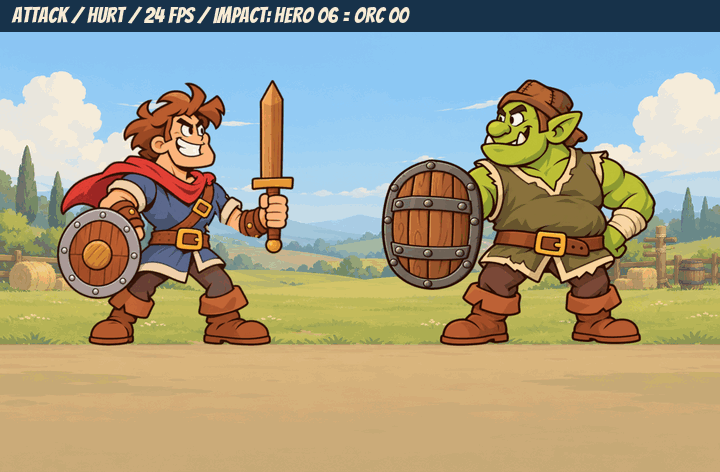

# Animation pilot — issue #21

Bộ thử trên `art/anim-pilot`, từ main `0cd4159`. Chỉ thêm ảnh và tài liệu trong assets/ và docs/ideas/.

## Sửa vệt kiếm ở frame 4–5

Đã bỏ lưỡi kiếm dựng đứng, cho lưỡi kéo thành vệt cong từ trên-sau xuống trước; tay và chuôi nằm ở đầu vệt. Frame 5 có vệt dài hơn frame 4. Mười frame khác và toàn bộ anim.json giữ nguyên.

[Ảnh phóng to frame 3–6](hero_attack_frames_03_06_zoom.png) · [Trước/sau](hero_attack_smear_before_after.png) · [Đối chiếu pixel](smear_revision_checks.json) · [Bàn giao bản sửa](smear_revision_notes.md)

## GIF để duyệt

| Clip | Frame nguồn / tốc độ | GIF | WebP lossless |
|---|---|---|---|
| Hiệp sĩ thở, khăn bay, chớp mắt | 8 / 12 fps, lặp | [Xem GIF](hero_idle.gif) | [WebP](hero_idle.webp) |
| Hiệp sĩ chém | 12 / 24 fps | [Xem GIF](hero_attack.gif) | [WebP](hero_attack.webp) |
| Orc thở, nhún vai | 8 / 12 fps, lặp | [Xem GIF](orc_idle.gif) | [WebP](orc_idle.webp) |
| Orc trúng đòn | 8 / 24 fps | [Xem GIF](orc_hurt.gif) | [WebP](orc_hurt.webp) |
| Vệt chém trắng-vàng | 8 / 24 fps | [Xem GIF](slash.gif) | [WebP](slash.webp) |

### Ghép đòn chém và phản ứng

[Bản WebP lossless](attack_vs_hurt.webp) · [Ảnh dừng tại khung chạm](impact_alignment.png)

Hiệp sĩ chạm ở frame **6**, tức **250 ms**. Cùng lúc đó Orc bắt đầu hurt frame **0**. Vệt chém bắt đầu ở frame 3 và đạt pha chạm ở frame 6. Orc kết thúc hurt ở frame 13 của đoạn ghép; sau đó nghỉ 12 frame trước lượt phát lại.

GIF ghép mô phỏng phần lao cả người mà game điều khiển. Cử động tay/kiếm, thân, khăn và biểu cảm nằm trong PNG; chân của từng frame nguồn vẫn tại (256,500). Khiên Orc được chồng riêng trong GIF ghép theo từng điểm shield, không nằm trong atlas thân Orc.

## Kiểm tra từng frame

[Toàn bộ 44 frame đánh số](all_frames_numbered.png)

- [Hero idle](hero_idle_numbered.png), [hero attack](hero_attack_numbered.png).
- [Orc idle](orc_idle_numbered.png), [Orc hurt](orc_hurt_numbered.png).
- [Slash](slash_numbered.png).

Các preview dùng nền xanh đậm để soi alpha và đường biên. Atlas không có chữ, nền hay ký hiệu của ảnh review.

## Giữ nhất quán

Các tư thế được dựng offline từ nét vẽ gốc: tái sử dụng cùng một tay cầm kiếm và cùng texture kiếm, vẽ bù vùng áo bị che, biến dạng nhẹ thân/khăn và ghép phần mí mắt/biểu cảm. Mặt, mũ, hoa văn áo, thắt lưng và các chi tiết nguồn được giữ trong cùng một bộ hình; mỗi frame đã được baked vào atlas.

Dùng khung giữ ở các đoạn phù hợp. Hero attack có 8 hình khác nhau trong 12 frame; Orc hurt có 5 hình trong 8 frame. Frame chạm 6 và theo đà 7 là hai hình riêng. Hurt 0–2 giật đầu, 3–5 lảo đảo/hồi tỉnh, 6–7 về đứng.

Phần ủng/chân từ y=440 đến đáy canvas được khóa pixel giữa tất cả frame của mỗi nhân vật. Hero attack 10–11 và Orc hurt 6–7 khớp pixel với idle frame 0 của nhân vật tương ứng.

## Tốc độ phát

GIF dùng độ trễ phân bổ 4/5 centisecond cho 24 fps và 8/9 centisecond cho 12 fps. Các clip 8 frame được lặp ba vòng trong file preview để tổng thời lượng khớp chính xác tốc độ trung bình; GIF review tiếp tục lặp để dễ xem. WebP lossless giữ độ trễ tới millisecond và có thể gộp các frame giữ.

Clip game vẫn là 8/12 frame theo anim.json. Thời lượng một vòng: idle 8/12 = 2/3 giây; attack 12/24 = 0.5 giây; hurt/slash 8/24 = 1/3 giây. Idle chớp mắt một lần mỗi vòng theo quy cách pilot.

Số frame được mã hóa trong GIF/WebP có thể khác số frame atlas do gộp khung giữ. [timing.json](timing.json) ghi thời lượng đã đọc lại từ file, nhịp và timeline đoạn ghép. [frame_checks.json](frame_checks.json) ghi checksum từng frame, alpha, số hình khác nhau và kiểm tra chân/khung hồi đòn.

## Atlas dành cho game

| File | Canvas | Lưới / frame |
|---|---|---|
| [hero fresh_idle.png](../../../assets/characters/hero_rookie/anim/fresh_idle.png) | 2048×1024 | 4 cột, 8 frame 512×512 |
| [hero fresh_attack.png](../../../assets/characters/hero_rookie/anim/fresh_attack.png) | 2048×1536 | 4 cột, 12 frame 512×512 |
| [Orc fresh_idle.png](../../../assets/characters/orc_shield/anim/fresh_idle.png) | 2048×1024 | 4 cột, 8 frame 512×512 |
| [Orc fresh_hurt.png](../../../assets/characters/orc_shield/anim/fresh_hurt.png) | 2048×1024 | 4 cột, 8 frame 512×512 |
| [slash.png](../../../assets/fx/combat/anim/slash.png) | 1536×768 | 4 cột, 8 frame 384×384 |

Kèm anim.json trong từng thư mục; Orc có đủ 8 điểm shield cho mỗi clip. Tất cả atlas là PNG RGBA 8-bit, biên ngoài từng frame có alpha 0, frame cuối slash trong suốt hoàn toàn.

Chờ người dùng duyệt pilot trước các đòn và mức thương tích tiếp theo.
