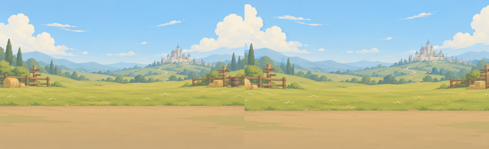
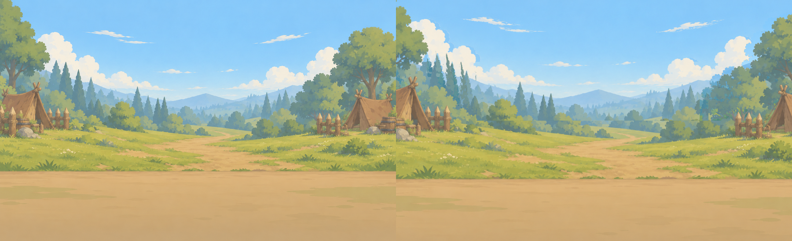

# Issue #17 — nền bảng và lớp đấu trường

Nhánh: `art/arena-layers`, tạo từ `origin/main` tại `aeefd30e367f3e87c6533d85285d72495aa7068c`.

GitHub API trả `Forbidden` khi đọc issue. Bàn giao tại đây theo yêu cầu; chưa đăng được comment hay tạo PR bằng API.

## Xem thử

## Tích hợp

- Backdrop đặt (0,660), panel đặt (20,660); panel có lỗ alpha chính xác x=30..1009, y=30..1149, tức 980×1120. Slot 140×140, gạch 128×128 căn giữa. Không vẽ lại gạch.
- Thứ tự nền: sky → far → mid → ground. Bốn lớp ở (0,0), canvas 1080×660. Mặt đất bắt đầu y=470. Bản ghép tĩnh khớp từng pixel với gốc (xem metrics.json).
- Sky không có mây. Các dải mây xa gốc được giữ trong far để bảo toàn bản ghép; cloud_1..3 là chi tiết trôi bổ sung, không phải những mảnh mây gốc đã bóc. Atlas mới và cỏ có alpha nền trong suốt.
- layers.json ghi vị trí gốc, sprite_origins và sprite_scales theo canvas con. Scale là gợi ý để cờ/đuốc/cỏ hợp tỉ lệ cảnh; nhân origin với scale khi đặt sprite. Dùng tọa độ origin khi đặt điểm chân. Bird 4 khung; flag, torch, smoke 6 khung, một hàng ngang. Khói đặt đáy tại miệng lều; cờ đặt chân cột.
- Parallax: far có phần vẽ bù sau cây/rào/lều, mid chồng xuống dưới ground để có dư ảnh. Đã kiểm tra bằng ảnh ghép ở zoom 1.10× và 1.15×, lệch far ±12 px, mid ±12 px, ground ±20 px; cả 8 bản ghép đều không có lỗ alpha. Dùng zoom tối thiểu 1.10× khi pan để có dư mép; ở zoom 1.0 giữ các lớp tại vị trí gốc. Không dùng độ lệch lớn tùy ý. Đây là kiểm định ảnh ghép, chưa phải kiểm định animation đã tích hợp trong engine.
- Particle và shine dùng RGB trắng, code tô màu. Ring và glow_outline có lỗ alpha. Bụi cỏ/mây phụ không baked vào bản ghép kiểm định.

## Kiểm tra

Backdrop đục; độ sáng trung bình 83.1% (Orc), 89.0% (training). Slot 89–90%. Cả hai phép so sánh pixel bản ghép đều đúng hoàn toàn. Các ảnh xem thử dùng gạch hiện có, không đổi source code. Bảy mask tint có RGB trắng ở mọi pixel alpha > 0. Cờ/đuốc/cỏ đã căn gốc cố định giữa các frame, khói không có matte trắng. Godot 4.7.2 import sạch; suite hiện có 49 passed, 0 failed. Chỉ assets/ và docs/ideas/ được đưa vào commit.

## Danh sách file

- `assets/ui/board_backdrop_orc_shield.png` — 1080×1260
- `assets/ui/board_backdrop_training.png` — 1080×1260
- `assets/ui/board_panel_orc_shield.png` — 1040×1180
- `assets/ui/board_panel_training.png` — 1040×1180
- `assets/ui/board_slot_orc_shield.png` — 140×140
- `assets/ui/board_slot_training.png` — 140×140
- `assets/bg/training_field/bird.png` — 384×64
- `assets/bg/training_field/cloud_1.png` — 320×128
- `assets/bg/training_field/cloud_2.png` — 320×128
- `assets/bg/training_field/cloud_3.png` — 320×128
- `assets/bg/training_field/far.png` — 1080×660
- `assets/bg/training_field/flag.png` — 768×128
- `assets/bg/training_field/grass.png` — 160×96
- `assets/bg/training_field/ground.png` — 1080×660
- `assets/bg/training_field/layers.json`
- `assets/bg/training_field/mid.png` — 1080×660
- `assets/bg/training_field/sky.png` — 1080×660
- `assets/bg/orc_camp/bird.png` — 384×64
- `assets/bg/orc_camp/cloud_1.png` — 320×128
- `assets/bg/orc_camp/cloud_2.png` — 320×128
- `assets/bg/orc_camp/cloud_3.png` — 320×128
- `assets/bg/orc_camp/far.png` — 1080×660
- `assets/bg/orc_camp/grass.png` — 160×96
- `assets/bg/orc_camp/ground.png` — 1080×660
- `assets/bg/orc_camp/layers.json`
- `assets/bg/orc_camp/mid.png` — 1080×660
- `assets/bg/orc_camp/sky.png` — 1080×660
- `assets/bg/orc_camp/smoke.png` — 768×192
- `assets/bg/orc_camp/torch.png` — 384×128
- `assets/fx/particles/glow.png` — 128×128
- `assets/fx/particles/ring.png` — 256×256
- `assets/fx/particles/shard.png` — 64×64
- `assets/fx/particles/spark.png` — 64×64
- `assets/fx/particles/star.png` — 64×64
- `assets/tiles/shine.png` — 128×128
- `assets/tiles/glow_outline.png` — 192×192
