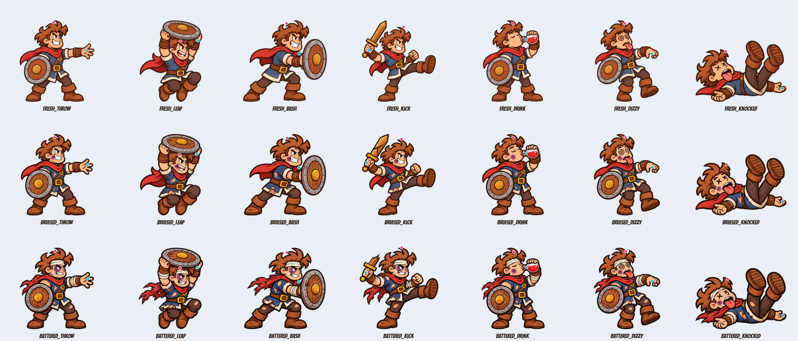
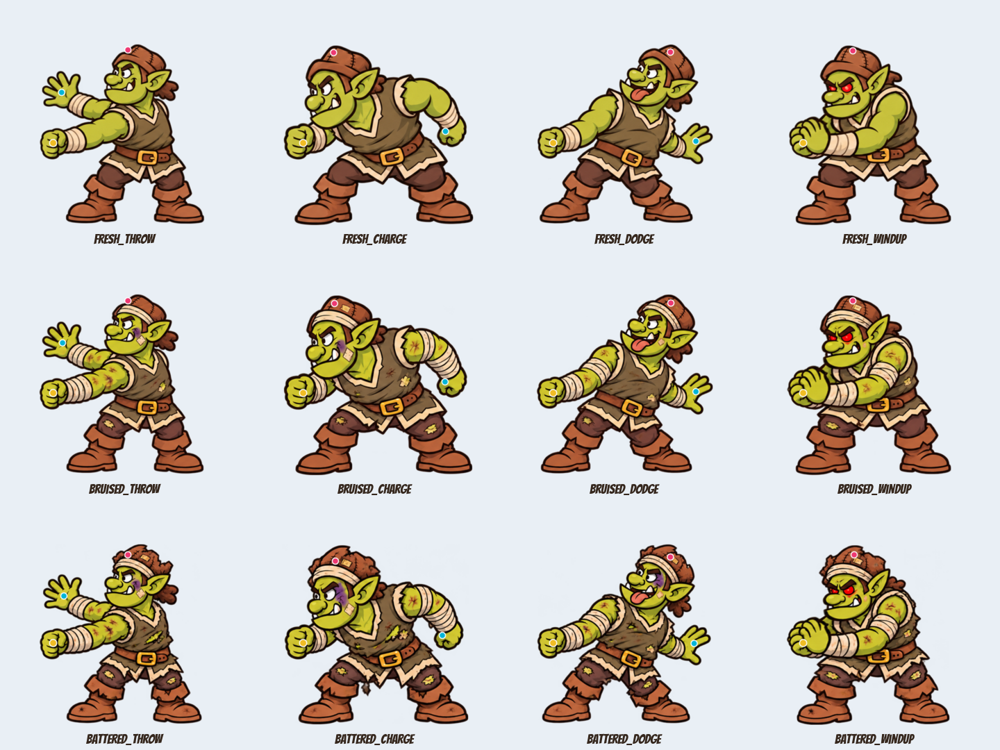
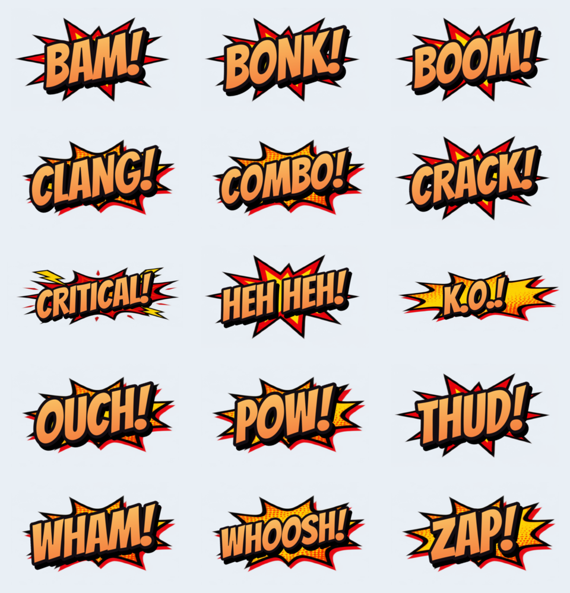
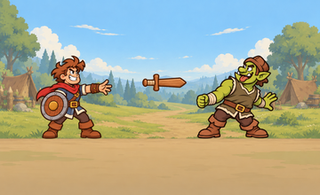
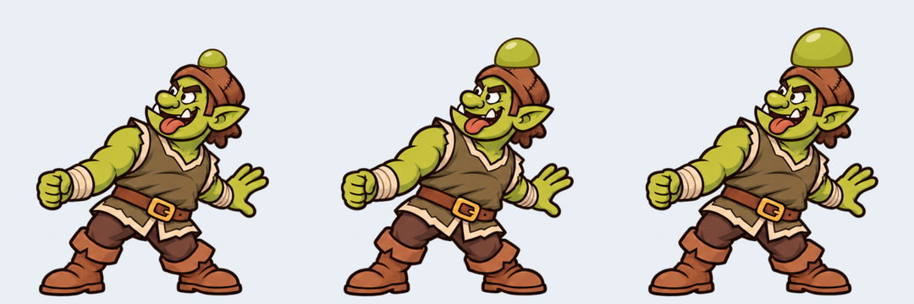

# Issue #18 — thế võ, chí mạng, thương tích và comic

Nhánh `art/combat-moves`, tạo độc lập từ `origin/main` tại `aeefd30e367f3e87c6533d85285d72495aa7068c`; không chứa commit #17.

GitHub API/GraphQL trả `Forbidden`, nên bàn giao trong file này. Chưa đăng comment hoặc tạo PR bằng API. Có thể tạo PR từ nhánh đã push, base main, tiêu đề: “Art: combat moves, critical hits and comic effects (#18)”.

## Xem thử

Mốc hồng là crown, xanh cyan là hand, vàng là shield. Mỗi PNG nhân vật 512×512, baseline 500, điểm gốc chân (256,500). Dáng nằm/ngồi/co chân vẫn dùng cùng điểm gốc, code điều khiển vị trí nhân vật khi nhảy/ngã.

## Nội dung và tích hợp

- Hero: 7 dáng × 3 mức. Throw không cầm kiếm, drink có bình máu đỏ, dizzy có mắt xoáy; kiếm/băng/bầm/rách tăng theo mức.
- Orc: 4 dáng × 3 mức, thêm bald.png. Không vẽ khiên vào nhân vật. Fist shield đã được đăng ký tại (95,319) cho 12 dáng; trường shield toàn cục vẫn giữ nguyên. Bald là dáng ôm đầu, nên code ẩn khiên khi dùng dáng này.
- Bổ sung crown và hand cho cả dáng cũ lẫn mới của hero/orc; scarecrow chỉ thêm crown. Giữ nguyên các head/mouth cũ và metadata gốc. Tất cả 75 pose rig có crown, 68 pose hero/orc có hand. Các mốc là tọa độ canvas gốc, không phải tọa độ thế giới.
- Props xoay quanh tâm canvas. Bump ba cỡ, đáy (64,120); đặt tại crown trừ điểm gốc đó. Không cần code sinh ảnh cục u.
- Comic dùng đúng Bangers tải từ Google Fonts, kèm nguyên giấy phép OFL. 13 file 512×320; CRITICAL! và K.O.! 900×360. Chữ nghiêng 9°, viền đen, bóng đổ, gradient vàng/cam/đỏ và nền burst. Chuỗi chính xác nằm trong comic_strings.json; chỉ tiếng Anh.
- crit_spark.png: atlas 1536×192, 8 khung 192×192, lặp theo pha quay; phần tile 128×128 ở (32,32) trong suốt hoàn toàn. Cùng atlas dùng cho cả hai bộ.
- speed_lines có vùng giữa trong suốt; các burst trống dành cho số và COMBO xN do code viết. Hai dải mắt 1080×300 hướng về đối thủ.

## Kiểm tra

75 PNG mới đúng kích thước và có alpha trong suốt. Tám frame crit khác nhau; từng vùng giữa 128×128 có alpha bằng 0. Sáu cục u có kích thước tăng dần và baseline 120. Mọi mốc nằm trong canvas; không có hand nào nằm ngoài vùng alpha lân cận 12 px. Lưới đã được soát bằng mắt, chữ dựng từ literal Bangers thay vì chữ sinh bằng ảnh.

Godot 4.7.2 import thành công, không SCRIPT ERROR/ERROR; suite hiện có: **49 passed, 0 failed**. Đây là bàn giao asset; chưa tích hợp các trigger combat mới vào code/scenes.

## Danh sách file asset

- `assets/characters/hero_rookie/fresh_throw.png`
- `assets/characters/hero_rookie/fresh_leap.png`
- `assets/characters/hero_rookie/fresh_bash.png`
- `assets/characters/hero_rookie/fresh_kick.png`
- `assets/characters/hero_rookie/fresh_drink.png`
- `assets/characters/hero_rookie/fresh_dizzy.png`
- `assets/characters/hero_rookie/fresh_knocked.png`
- `assets/characters/hero_rookie/bruised_throw.png`
- `assets/characters/hero_rookie/bruised_leap.png`
- `assets/characters/hero_rookie/bruised_bash.png`
- `assets/characters/hero_rookie/bruised_kick.png`
- `assets/characters/hero_rookie/bruised_drink.png`
- `assets/characters/hero_rookie/bruised_dizzy.png`
- `assets/characters/hero_rookie/bruised_knocked.png`
- `assets/characters/hero_rookie/battered_throw.png`
- `assets/characters/hero_rookie/battered_leap.png`
- `assets/characters/hero_rookie/battered_bash.png`
- `assets/characters/hero_rookie/battered_kick.png`
- `assets/characters/hero_rookie/battered_drink.png`
- `assets/characters/hero_rookie/battered_dizzy.png`
- `assets/characters/hero_rookie/battered_knocked.png`
- `assets/characters/orc_shield/fresh_throw.png`
- `assets/characters/orc_shield/fresh_charge.png`
- `assets/characters/orc_shield/fresh_dodge.png`
- `assets/characters/orc_shield/fresh_windup.png`
- `assets/characters/orc_shield/bruised_throw.png`
- `assets/characters/orc_shield/bruised_charge.png`
- `assets/characters/orc_shield/bruised_dodge.png`
- `assets/characters/orc_shield/bruised_windup.png`
- `assets/characters/orc_shield/battered_throw.png`
- `assets/characters/orc_shield/battered_charge.png`
- `assets/characters/orc_shield/battered_dodge.png`
- `assets/characters/orc_shield/battered_windup.png`
- `assets/characters/orc_shield/bald.png`
- `assets/fx/props/sword_fresh.png`
- `assets/fx/props/sword_bruised.png`
- `assets/fx/props/sword_battered.png`
- `assets/fx/props/rock.png`
- `assets/fx/props/club.png`
- `assets/fx/props/orc_hat.png`
- `assets/fx/props/scarecrow_hat.png`
- `assets/fx/props/tooth.png`
- `assets/fx/props/coin.png`
- `assets/fx/injury/bump_human_1.png`
- `assets/fx/injury/bump_human_2.png`
- `assets/fx/injury/bump_human_3.png`
- `assets/fx/injury/bump_orc_1.png`
- `assets/fx/injury/bump_orc_2.png`
- `assets/fx/injury/bump_orc_3.png`
- `assets/fx/combat/slash.png`
- `assets/fx/combat/slash_crit.png`
- `assets/fx/combat/shockwave.png`
- `assets/fx/combat/dust_puff.png`
- `assets/fx/combat/speed_lines.png`
- `assets/fx/combat/comic_burst_1.png`
- `assets/fx/combat/comic_burst_2.png`
- `assets/fx/combat/comic_burst_3.png`
- `assets/fx/combat/hero_eye_glint.png`
- `assets/fx/combat/orc_eye_glare.png`
- `assets/fx/comic/pow.png`
- `assets/fx/comic/bam.png`
- `assets/fx/comic/wham.png`
- `assets/fx/comic/bonk.png`
- `assets/fx/comic/clang.png`
- `assets/fx/comic/crack.png`
- `assets/fx/comic/zap.png`
- `assets/fx/comic/boom.png`
- `assets/fx/comic/whoosh.png`
- `assets/fx/comic/thud.png`
- `assets/fx/comic/ouch.png`
- `assets/fx/comic/heh.png`
- `assets/fx/comic/combo.png`
- `assets/fx/comic/critical.png`
- `assets/fx/comic/ko.png`
- `assets/tiles/crit_spark.png`
- `assets/characters/hero_rookie/rig.json`
- `assets/characters/orc_shield/rig.json`
- `assets/characters/scarecrow/rig.json`
- `assets/fonts/Bangers-Regular.ttf`
- `assets/fonts/Bangers-OFL.txt`
