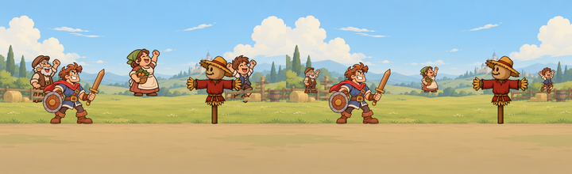
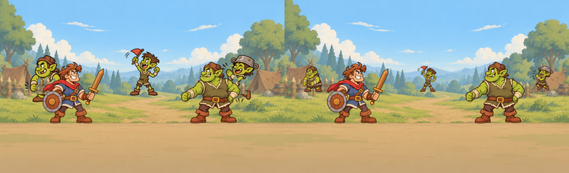

# Issue #19 — khán giả

Nhánh `art/crowd`, sửa tiếp từ commit `994b677` theo [comment mới của Claude](https://github.com/loc169434-design/Brick-hero/issues/19#issuecomment-6597273522). Bản cập nhật ngày 2026-11-03 này thay thế cách đặt trong bàn giao trước.

GitHub API đọc comment vẫn trả `Forbidden`; đã đọc yêu cầu qua trang issue. Nếu đăng comment tiếp tục bị chặn, dùng file này để bàn giao.

## Thay đổi mới

- Hai crowd.json thêm **scale: 0.55**. Ảnh nguồn vẫn 256×256, silhouette cao 180 px; khi hiển thị còn khoảng 99 px.
- Training: chân ở **(96,354), (540,350), (984,354)**, tương ứng id 1,2,3.
- Orc: chân ở **(100,350), (540,350), (980,350)**, tương ứng id 1,2,3.
- Các vị trí đều trên hàng xa y 350–354. Toàn bộ phần hình ở cả idle/cheer/boo tránh hai dải x 170–370 và 710–910, không chỉ kiểm tra tọa độ chân.
- **Đã xóa** assets/bg/training_field/crowd_fence.png và assets/bg/orc_camp/crowd_fence.png. Bỏ foreground_overlay và draw_order cũ khỏi hai JSON. Không dùng lớp rào riêng; nền đã có rào trong mid.
- Giữ nguyên byte-for-byte cả **18 PNG** và hai lưới biểu cảm. Không vẽ lại nhân vật.

## Ảnh xem thử mới

Đủ ba khán giả ở dáng cheer, scale 0.55, cùng hai nhân vật chính. Khán giả vẽ sau nền và trước fighters; không thêm bất kỳ lớp rào phụ nào. Canvas fighter của ảnh so sánh giữ nguyên 300×300 như bản cũ để nhìn được khác biệt về cỡ.

Có cả bản native 1080×660: [Training](issue19_review/training_field_battle_native.png), [Orc](issue19_review/orc_camp_battle_native.png), và ảnh chỉ nền + khán giả: [Training](issue19_review/training_field_cheer.png), [Orc](issue19_review/orc_camp_cheer.png).

## Tích hợp

crowd.json chỉ còn folder, scale, spots. spots là tọa độ chân theo khung nền 1080×660. Với scale s, góc trên trái sprite là (x − 128s, y − 248s); hoặc đặt node tại (x,y), giữ offset ảnh (−128,−248) và scale node bằng s. Nhân vật chính luôn vẽ phía trước khán giả. Giữ các lớp rào/cảnh sẵn có trong nền, bỏ mọi tham chiếu đến overlay rào riêng đã xóa.

Nông dân quay phải; Orc con quay trái. Orc boo là cười/chỉ trỏ. Timing reo hò và nhún/nhảy do phần tích hợp điều khiển.

## Kiểm tra đợt sửa

- Hai JSON parse đúng, scale là số 0.55, không còn key overlay hoặc draw_order cũ.
- Cả 18 checksum PNG khớp bản trước.
- 18/18 vùng hình sau scale nằm trong canvas và không giao hai dải x của fighters; mọi chân ở y 350–354, thuộc khoảng 330–370 yêu cầu.
- Đã xem lại ảnh ghép hai nền ở cỡ 360 px; không có khúc rào bay và không có crowd chồng lên đầu fighters.
- Số đo và checksum: [placement_fix_metrics.json](issue19_review/placement_fix_metrics.json). Đây là kiểm tra asset/metadata và ảnh ghép; chưa chạy lại phần tích hợp của Claude trong game.

## Lưới biểu cảm giữ nguyên

## Danh sách asset hiện tại

- `assets/characters/crowd_farmers/1_idle.png`
- `assets/characters/crowd_farmers/1_cheer.png`
- `assets/characters/crowd_farmers/1_boo.png`
- `assets/characters/crowd_farmers/2_idle.png`
- `assets/characters/crowd_farmers/2_cheer.png`
- `assets/characters/crowd_farmers/2_boo.png`
- `assets/characters/crowd_farmers/3_idle.png`
- `assets/characters/crowd_farmers/3_cheer.png`
- `assets/characters/crowd_farmers/3_boo.png`
- `assets/characters/crowd_orcs/1_idle.png`
- `assets/characters/crowd_orcs/1_cheer.png`
- `assets/characters/crowd_orcs/1_boo.png`
- `assets/characters/crowd_orcs/2_idle.png`
- `assets/characters/crowd_orcs/2_cheer.png`
- `assets/characters/crowd_orcs/2_boo.png`
- `assets/characters/crowd_orcs/3_idle.png`
- `assets/characters/crowd_orcs/3_cheer.png`
- `assets/characters/crowd_orcs/3_boo.png`
- `assets/bg/training_field/crowd.json`
- `assets/bg/orc_camp/crowd.json`
