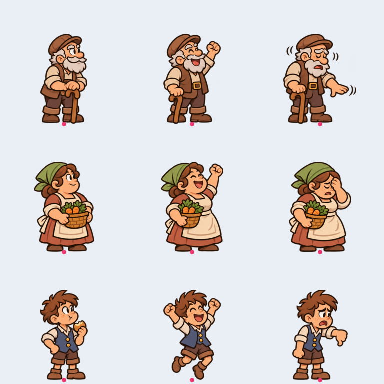
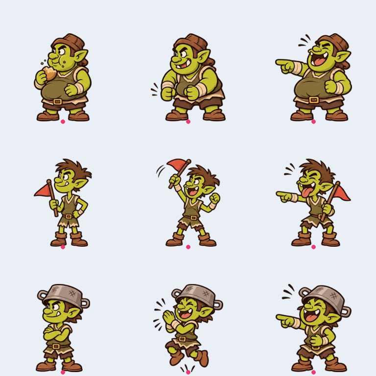
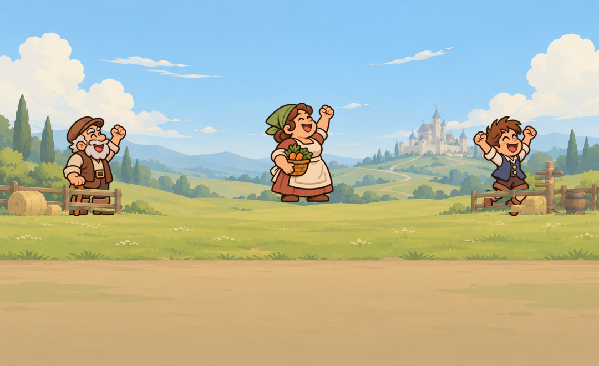
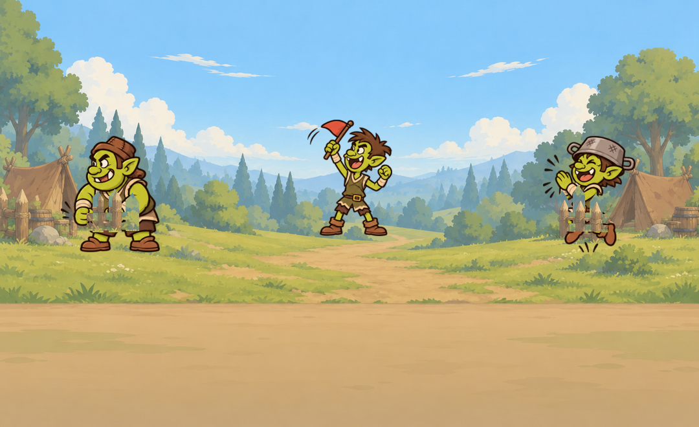
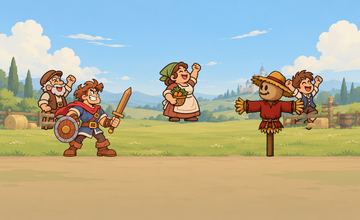
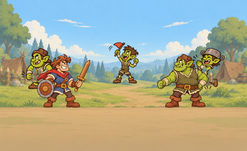

# Issue #19 — khán giả

Nhánh `art/crowd` tạo độc lập từ main mới nhất `aeefd30e367f3e87c6533d85285d72495aa7068c`; không chứa commit #17/#18.

GitHub API/GraphQL trả Forbidden; bàn giao tại đây theo yêu cầu. Chưa đăng comment hoặc tạo PR bằng API. Tiêu đề PR đề nghị: “Art: farmer and Orc spectators with arena placement (#19)”.

## Xem thử

## Tích hợp

- 3 nông dân: ông già chống gậy, bà bán rau, cậu bé; quay phải. 3 Orc con: béo, gầy cầm cờ, đội nồi; quay trái. Mỗi người đủ idle, cheer, boo. Orc boo là cười/chỉ trỏ khi hero bị đánh.
- Tất cả canvas 256×256, alpha trong suốt, điểm chân (128,248), silhouette cao 180 px. Không có bóng nền baked. Hai bộ cùng viền nâu và mảng màu của nhân vật hiện có.
- crowd.json dùng tọa độ chân trong canvas nền 1080×660: (170,390), (540,365), (910,390), lần lượt id 1,2,3. Đặt sprite tại spot trừ (128,248). Người giữa đứng phía sau lối vào, hai người hai bên sau hàng rào.
- Thứ tự: mid → crowd → crowd_fence → ground → fighters. Khán giả luôn vẽ dưới hai nhân vật chính.
- **Bổ sung crowd_fence.png:** canvas 1080×660, alpha chỉ giữ các thanh/cọc rào lấy từ đúng ảnh nền gốc. Vẽ tại (0,0) sau crowd để chân không đè lên rào. Đây là overlay bổ sung cần thiết vì mid gốc vẽ trước khán giả; không phải ảnh nền mới. Nếu tích hợp parallax, overlay rào phải dùng cùng transform với hàng rào trong mid. crowd.json có foreground_overlay và draw_order để ghi rõ điều này.
- Không sửa code, scenes, tests hoặc project.godot. Động tác nhún/nhảy/timing phản ứng do code điều khiển.

## Kiểm tra

18/18 PNG nhân vật đúng kích thước 256×256, nền alpha, cao đúng 180, chân baseline 248. Hai overlay đúng 1080×660. Lưới và ảnh ghép đã được xem lại; nhân vật chính được vẽ sau crowd nên không bị crowd che. Godot 4.7.2 import sạch; suite hiện có 49 passed, 0 failed. Chưa gắn trigger reo hò vào trận bằng code.

## Danh sách file

- `assets/characters/crowd_farmers/1_idle.png`
- `assets/characters/crowd_farmers/1_cheer.png`
- `assets/characters/crowd_farmers/1_boo.png`
- `assets/characters/crowd_farmers/2_idle.png`
- `assets/characters/crowd_farmers/2_cheer.png`
- `assets/characters/crowd_farmers/2_boo.png`
- `assets/characters/crowd_farmers/3_idle.png`
- `assets/characters/crowd_farmers/3_cheer.png`
- `assets/characters/crowd_farmers/3_boo.png`
- `assets/characters/crowd_orcs/1_idle.png`
- `assets/characters/crowd_orcs/1_cheer.png`
- `assets/characters/crowd_orcs/1_boo.png`
- `assets/characters/crowd_orcs/2_idle.png`
- `assets/characters/crowd_orcs/2_cheer.png`
- `assets/characters/crowd_orcs/2_boo.png`
- `assets/characters/crowd_orcs/3_idle.png`
- `assets/characters/crowd_orcs/3_cheer.png`
- `assets/characters/crowd_orcs/3_boo.png`
- `assets/bg/training_field/crowd.json`
- `assets/bg/orc_camp/crowd.json`
- `assets/bg/training_field/crowd_fence.png`
- `assets/bg/orc_camp/crowd_fence.png`
