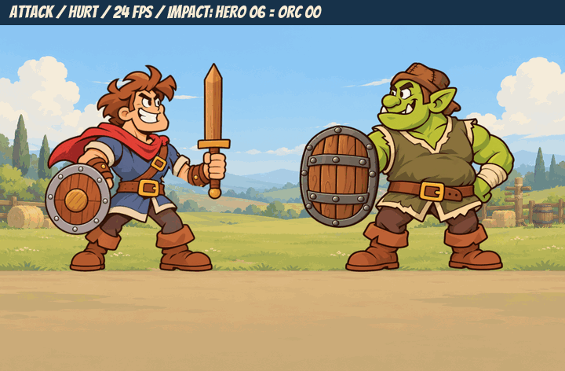

# Issue #21 — animation pilot

Nhánh **art/anim-pilot**, tạo từ main **0cd4159**. Chỉ thêm assets/ và docs/ideas/; giữ nguyên scripts/, scenes/, tests/ và project.godot.

## Duyệt hình động

[Trang đủ 5 GIF riêng, WebP lossless và atlas](anim_pilot_review/README.md)

- [Hero idle — 8 frame / 12 fps](anim_pilot_review/hero_idle.gif).
- [Hero attack — 12 frame / 24 fps](anim_pilot_review/hero_attack.gif).
- [Orc idle — 8 frame / 12 fps](anim_pilot_review/orc_idle.gif).
- [Orc hurt — 8 frame / 24 fps](anim_pilot_review/orc_hurt.gif).
- [Slash — 8 frame / 24 fps](anim_pilot_review/slash.gif).
- [Lưới đủ 44 frame có đánh số](anim_pilot_review/all_frames_numbered.png).

Bản ghép cho Orc hurt bắt đầu đúng lúc hero tới frame 6 (250 ms). Phần lao cả người được mô phỏng riêng trong preview, còn chuyển động trong từng frame nằm trong atlas. Khiên là lớp rời trong preview và đi theo shield[]; thân Orc không có khiên baked vào.

## Quy cách và tính nhất quán

Atlas đúng 4 cột, đọc ngang rồi xuống. Hero/Orc frame 512×512, chân tại (256,500); slash frame 384×384. anim.json theo đúng issue, hero attack có impact: 6; mỗi clip Orc có đủ điểm shield từng frame.

Dùng chung nét gốc và phần hình cầm kiếm để giữ thiết kế ổn định, vẽ bù vùng khuất, tạo chuyển động thân/khăn và biểu cảm rồi baked ra PNG. Có khung giữ; không sinh lại một nhân vật độc lập cho từng frame. Hero attack có 7 hình khác nhau, Orc hurt có 5 hình khác nhau.

Đã kiểm tra layout/alpha của đủ 44 frame, viền canvas trong suốt, kiếm không bị cắt mép. Chân/ủng khóa pixel ở mọi frame. Hai frame hồi cuối attack/hurt khớp idle frame 0. Đã kiểm tra các điểm shield nằm trên phần hình nắm tay và nằm trong canvas.

GIF có palette chung để giảm nhấp nháy màu. Độ trễ được phân bổ theo giới hạn centisecond, tổng thời lượng đọc lại đúng fps trung bình 12/24. Kèm WebP lossless. Chi tiết: [frame checks](anim_pilot_review/frame_checks.json), [timing](anim_pilot_review/timing.json).

Đây là bản thử để duyệt cảm giác chuyển động. Chưa triển khai thêm đòn/mức thương tích khác.

## Trạng thái bàn giao

GitHub API đọc issue trả Forbidden; quy cách đã được đọc qua trang issue. Sau khi push sẽ thử comment trực tiếp và tạo draft PR. Nếu API tiếp tục bị chặn, file này và thư mục review là bàn giao để người dùng/Claude đọc.

## Danh sách file

Xem [files.txt](anim_pilot_review/files.txt), gồm 5 atlas, 3 anim.json và các GIF/WebP/ảnh lưới/báo cáo trong docs/ideas/.
