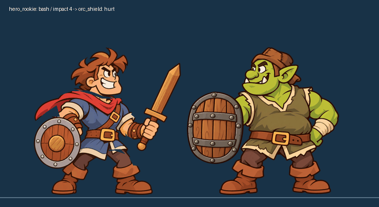

# Issue #24 — hoạt hình các đòn còn lại

Nhánh `art/anim-moves`, tạo từ `main` tại `8f07dfb`. Chỉ thay đổi `assets/` và `docs/ideas/`. Người dùng đã chọn dựng bằng Python/Pillow từ ảnh gốc để giữ chi tiết giữa các khung. Công cụ dựng offline ở [build_anim_moves.py](build_anim_moves.py); không phải code game.

## Đợt 1 — hiệp sĩ, fresh

Thêm 12 atlas: `throw`, `leap`, `kick`, `bash`, `drink`, `hurt`, `dizzy`, `knocked`, `scared`, `cheer`, `victory`, `defeat` vào `assets/characters/hero_rookie/anim/`. Mỗi file tên `fresh_<clip>.png`, RGBA, lưới 4 cột, ô 512×512; ô thừa trong suốt. `anim.json` bổ sung đúng số khung, fps, loop, impact của #24. Các clip và PNG có sẵn của #21 giữ nguyên.

- `throw`: từ frame 4 tay không; không có kiếm bay baked vào atlas. Theo quy định riêng của clip, khung cuối là thế thủ **tay không**, tương đương idle nhưng không thể khớp pixel với idle cầm kiếm. Cần code điều khiển việc trả kiếm; không sửa code trong nhánh này.
- `leap`: impact 10, kiếm nằm trong vệt quét ở 9–10, không còn bản lưỡi dựng ở vị trí cũ.
- `kick`: impact 3; `bash`: impact 4. Pha lấy đà, chạm, thu đòn tách biệt.
- Các clip không lặp còn lại kết thúc bằng đúng pixel `fresh_idle` frame 0; `defeat` giữ tư thế ngã. Không dùng di chuyển toàn thân để giả động tác tay/chân; game vẫn điều khiển đường lao/nhảy.

### GIF để duyệt

Mỗi clip có GIF đúng tốc độ trung bình, WebP lossless và ảnh lưới đánh số trên nền xanh đậm trong [anim_moves_review](anim_moves_review/). GIF lặp để dễ duyệt, độc lập với cờ loop trong game. Thời gian GIF lượng tử 10 ms được phân bổ 4/5 ms×10 hoặc 8/9 ms×10; ba vòng nguồn loại sai lệch trung bình ở clip 8/10/16 khung. WebP lượng tử 1 ms.

### Kiểm tra

- [Đợt 1: kích thước, số khung, fps, impact, alpha, checksum từng khung, khung hồi](anim_moves_review/batch1_checks.json).
- [Bộ thử #21 giữ nguyên và thời lượng đọc lại từ GIF](anim_moves_review/pilot_preservation.json).
- [Timeline GIF ghép](anim_moves_review/batch1_timing.json): Orc bắt đầu hurt đúng frame impact của mỗi đòn.
- Đây là bàn giao ảnh để duyệt hình và nhịp; không tuyên bố đã tích hợp các đòn mới vào game.

### Comment đợt 1 để đăng vào #24

Đợt 1 hiệp sĩ fresh đã có trên nhánh `art/anim-moves`: 12 clip mới và metadata, giữ nguyên bộ thử #21. Kèm GIF từng clip, ảnh lưới đánh số và GIF ghép kick/bash/leap với Orc hurt đúng impact. [Bàn giao và GIF](https://github.com/loc169434-design/Brick-hero/blob/art/anim-moves/docs/ideas/issue24_handoff.md).

API GitHub đọc issue qua cả GraphQL và REST trả `Forbidden`; trang issue và Git HTTPS vẫn đọc được. Nếu lệnh comment cũng bị chặn, dùng nội dung bàn giao này theo phương án dự phòng trong #24.
