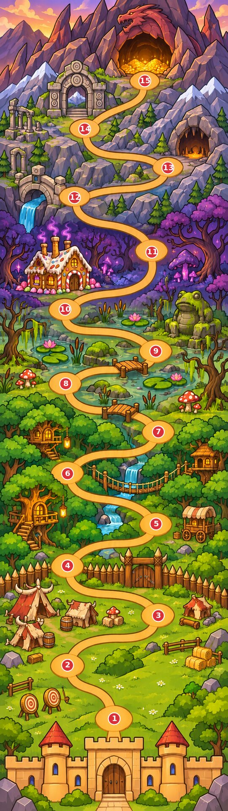

# Issue #28 — bản đồ thế giới dài

Nhánh `art/long-map`, tạo từ `main` mới nhất tại `5842c49`. Chỉ thay asset bản đồ và tài liệu/ảnh review trong `docs/ideas/`; không sửa code, scene, test hoặc dữ liệu chiến dịch.

## Bàn giao

- `assets/bg/world_map.png`: **1080×3840**, RGB, PNG không mất dữ liệu. 15 khoảng đất trống trên một con đường liên tục, không còn nhánh cụt/điểm thừa ở bãi tập.
- `assets/bg/world_map.json`: array 15 mục `{id,x,y,region}` đúng ID và thứ tự của #28; tọa độ pixel trên ảnh cuối, gốc ở góc trên trái, đi từ dưới lên.
- Đủ 7 vùng: lâu đài/bãi tập; đồng cỏ và trại Orc; rừng Goblin có chòi cây/xe hàng; đầm lầy Cóc có lá súng/cây khô/nấm; rừng đen có nhà bánh gừng **ba ống khói**; vùng núi có cầu đá/hang dơi/cổng cổ; hang rồng và kho vàng.
- Ảnh production không có chữ, số, khóa, cờ, banner hoặc nhân vật/UI baked. Họa tiết cổng núi là vòng đá hình học, không phải chữ.

## Ảnh xem thử, mỗi file dưới 2 MB

- [Toàn bản đồ 540×1920, chấm đỏ đánh số 1–15](long_map_review/world_map_nodes.jpg): 331.405 byte.
- [Cắt chính xác 1080×1920 ở đáy, không overlay](long_map_review/bottom_map_crop.jpg): 411.256 byte.
- [Cùng crop, đặt thử bù nhìn và Orc tại đúng tọa độ](long_map_review/bottom_screen_characters.jpg): 414.874 byte.

Ảnh đặt nhân vật là minh họa bố cục offline, không phải screenshot của PR #27. Dùng đúng ảnh hiện có, canvas nhân vật thu về 240 px, chân nguồn (256,500) đặt vào tâm điểm dừng. Ụ đất, nhân vật và nhãn chỉ chồng trong ảnh review; không nằm trong world_map.png. Các quái mới chưa có ảnh trên main không bị thay bằng một ảnh quái khác để giả làm đầy đủ.

## Tọa độ

| # | ID | Vùng | x | y |
|---|---|---:|---:|---:|
| 1 | `scarecrow` | 0 | 540 | 3402 |
| 2 | `orc_shield` | 1 | 319 | 3149 |
| 3 | `orc_rock` | 1 | 749 | 2914 |
| 4 | `orc_chief` | 1 | 319 | 2678 |
| 5 | `goblin_thief` | 2 | 738 | 2480 |
| 6 | `goblin_archer` | 2 | 319 | 2242 |
| 7 | `goblin_boss` | 2 | 749 | 2044 |
| 8 | `toad_hopper` | 3 | 310 | 1816 |
| 9 | `frost_slime` | 3 | 737 | 1662 |
| 10 | `toad_witch` | 3 | 307 | 1464 |
| 11 | `witch_house` | 4 | 718 | 1193 |
| 12 | `stone_golem` | 5 | 352 | 935 |
| 13 | `cave_bat` | 5 | 794 | 794 |
| 14 | `mountain_gate` | 5 | 400 | 610 |
| 15 | `royal_dragon` | 6 | 685 | 382 |

## Đã kiểm tra

- PNG mở được, đúng 1080×3840; JSON parse được, đúng 15 ID duy nhất, region đúng `[1,3,3,3,1,3,1]` điểm mỗi vùng.
- Khoảng cách tâm nhỏ nhất trong **mọi cặp điểm**: **328.525 px**, vượt yêu cầu 230 px. Đây là khoảng cách Euclid trong mặt phẳng ảnh, không phải khoảng cách theo chiều dọc riêng lẻ.
- Lề ngang tâm điểm nhỏ nhất: **286 px**, vượt yêu cầu 140 px.
- Cả 15 vùng mẫu quanh tâm (41×21 px) đều nằm trên màu đất trống. Đã xem overlay toàn bản đồ để đối chiếu tâm các khoảng đất; các khoảng rộng xấp xỉ 150 px hoặc hơn.
- Đã xem lại thủ công: đúng 15 khoảng đất; đường đi không rẽ nhánh ở bãi tập; đủ bảy cảnh; nhà bánh gừng có ba ống khói; không chữ/khóa/cờ trong asset production.
- Cả ba ảnh preview đúng kích thước và nhỏ hơn 2.000.000 byte. [Kết quả đo, mọi cặp khoảng cách và SHA-256](long_map_review/validation.json).
- Chưa khẳng định hành vi cuộn hoặc chiến dịch trong game; nhánh này chỉ bàn giao ảnh và tọa độ cho phần tích hợp PR #27.

## Nội dung comment để đăng vào #28

Đã làm bản đồ dài 1080×3840 trên `art/long-map`, đủ 15 điểm qua 7 vùng, kèm world_map.json đúng ID/region. Không vẽ chữ, khóa, cờ hoặc UI lên ảnh. Tâm điểm cách nhau tối thiểu 328,525 px; lề ngang nhỏ nhất 286 px. Mỗi ảnh review dưới 0,42 MB. [Bản đồ đánh số](https://github.com/loc169434-design/Brick-hero/blob/art/long-map/docs/ideas/long_map_review/world_map_nodes.jpg) · [Crop đáy có nhân vật đứng thử](https://github.com/loc169434-design/Brick-hero/blob/art/long-map/docs/ideas/long_map_review/bottom_screen_characters.jpg) · [Bàn giao, tọa độ và kiểm tra](https://github.com/loc169434-design/Brick-hero/blob/art/long-map/docs/ideas/issue28_handoff.md).

## Bổ sung theo yêu cầu: chuyển động nhẹ

- [WebP động 540×1920](long_map_review/world_map_motion.webp), khoảng 0,58 MB; [GIF động 270×960](long_map_review/world_map_motion.gif), khoảng 0,22 MB. Vòng 4 giây / 12 fps. Cả hai dưới 2 MB.
- Khói ba ống khói nhà bánh gừng trôi nhẹ lên; nước sông lấp lánh; kho vàng trong hang rồng nhấp nháy nhỏ. Không cho bản đồ rung, zoom hoặc các điểm dừng dịch chuyển.
- `assets/bg/world_map_fx/`: ba texture RGBA tái sử dụng từ bộ ảnh hiện có và `anim.json` mô tả kích thước map, tọa độ map-local, pha, thời gian vòng, cỡ và biên độ hiệu ứng.
- Dựng offline bằng [build_long_map_motion.py](build_long_map_motion.py), theo cách dựng từ ảnh gốc bằng Python/Pillow đã chọn; không sửa code game. [Kiểm tra hiệu ứng và thời lượng giải mã](long_map_review/motion_validation.json): vòng 4.000 ms, chỉ vùng hiệu ứng thay đổi; PNG nền và JSON 15 điểm giữ nguyên.
- **Chưa tự chạy trong game:** loader bản đồ hiện tại không tự đọc `world_map_fx/anim.json`. Phần code tích hợp cần chồng các emitter lên ảnh map, cho chúng cuộn cùng map. PNG production vẫn là ảnh tĩnh; không biến texture nền thành GIF để thay đường dẫn đang dùng.

### Quy ước chuyển động cho phần tích hợp

Các vị trí trong `anim.json` đều tính trên ảnh 1080×3840, không phải viewport. Đọc 4 frame khói từ trái qua phải trên atlas; mỗi emitter có pha riêng. Trong một vòng, khói đi lên 65 px, trôi ngang 12 px, alpha theo `sin(pi*phase)^1.5`; tint tím nhạt và alpha tối đa 0,8 nhân alpha gốc. Khói fade về 0 trước khi bắt đầu vòng mới. Glint nước đi xuống 12 px/vòng 2 giây, alpha theo `sin(pi*phase)^2`. Vàng pulse theo nửa sóng sin lũy thừa 4, vòng 4 giây; các điểm lệch pha. Đường đi và quái/UI nằm yên theo tọa độ map trong lúc các lớp nhỏ này chuyển động. Không cần vẽ lại bản đồ nền.
