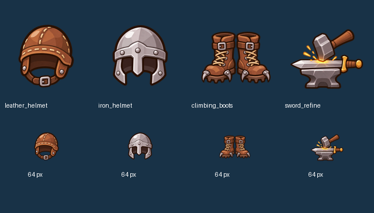

# Issue #30 — biểu tượng trang bị và hoạt hình thợ rèn

Nhánh `art/gear`, tạo từ `main` tại `fb87b63`. Phạm vi được yêu cầu: **phần 1 và phần 3**. Phần 2 (thay kiếm/nón trên mọi hoạt hình hiệp sĩ) chưa thực hiện, chờ duyệt phần 1 theo issue. Chỉ sửa `assets/` và `docs/ideas/`, không sửa code game, scene hoặc test.

## Phần 1 — bốn biểu tượng

Trong `assets/ui/items/`, PNG RGBA 256×256, nền trong suốt, viền nâu đậm, không chữ/số/+:

- `leather_helmet.png`: mũ da tròn có quai và đường khâu.
- `iron_helmet.png`: mũ sắt xám có sống mũ, đinh tán.
- `climbing_boots.png`: đôi ủng cao cổ, dây buộc, đế răng cưa và móc sắt.
- `sword_refine.png`: búa chạm lưỡi kiếm trên đe, tóe lửa; +1/+2/+3 do code chồng sau.

[Kiểm tra kích thước, alpha, biên và SHA-256](gear_review/part1_checks.json). Preview PNG 88.742 byte, dưới 2 MB. Sáu biểu tượng có sẵn không thay đổi. Các icon mới được vẽ theo hình tham chiếu hiện có rồi tách/chuẩn hóa từng ô, không dùng lại một icon cũ để thay tên món.

### Nội dung comment phần 1

Phần 1 đã có trên `art/gear`: bốn icon leather_helmet/iron_helmet/climbing_boots/sword_refine, RGBA 256×256, không chữ, cùng kiểu viền nâu với bộ cũ. [Ảnh duyệt cỡ lớn và 64px](https://github.com/loc169434-design/Brick-hero/blob/art/gear/docs/ideas/gear_review/items.png) · [Bàn giao và kiểm tra](https://github.com/loc169434-design/Brick-hero/blob/art/gear/docs/ideas/issue30_handoff.md). Phần 2 chưa làm, đúng yêu cầu chờ duyệt; phần 3 thợ rèn được làm cùng đợt này theo yêu cầu bổ sung.

Phần 1 đã push commit `51e44ac`. Lệnh comment #30 sau push bị chặn: `Post "https://api.github.com/graphql": Forbidden`; nội dung phần 1 ở trên chưa được đăng lên issue.

## Phần 3 — hoạt hình thợ rèn, chỉ fresh

Bốn atlas trong `assets/characters/blacksmith/anim/`, kèm `anim.json`. PNG RGBA trong suốt, lưới 4 cột, khung 512×512, quay trái, chân nguồn (256,500). Tổng **34 khung**.

| Clip | Khung | FPS | Lặp | Chạm |
|---|---:|---:|---|---:|
| idle | 8 | 12 | Có | — |
| talk | 8 | 12 | Có | — |
| hammer | 6 | 24 | Không | **3** |
| cheer | 12 | 12 | Không | — |

Dùng lại các hàm tách bộ phận, biến đổi quanh khớp và ghép RGBA của `docs/ideas/build_anim_moves.py` (#24), qua [build_blacksmith_anim.py](build_blacksmith_anim.py). Giữ cùng đầu, tóc, ria, tạp dề, kìm treo, búa và bàn tay nguồn. Thay tư thế từng khung, không lấy một ảnh đứng rồi trượt cả người. Lau trán bằng cẳng tay đang giữ búa; búa vẫn ở cùng tay. Miệng talk mở/đóng, cheer có mắt cười và miệng mở.

Frame 2 hammer có vệt kim loại theo cung quét, đầu búa hiện tại nằm trong vệt; không còn búa ở tư thế thấp cũ. `impact: 3` tương ứng **0,125 giây**. Frame cuối mỗi clip khớp nguyên pixel với idle frame 0; vùng ủng/chân giữ nguyên trong mọi khung. Ô thừa ở atlas 6 khung trong suốt.

### GIF duyệt phần 3 — không dùng PNG/WebP preview

- [Idle: thở, đung đưa búa, lau trán](gear_review/blacksmith_idle.gif) · [Lưới đánh số dạng GIF](gear_review/blacksmith_idle_numbered.gif).
- [Talk: khoa búa, mở/đóng miệng](gear_review/blacksmith_talk.gif) · [Lưới GIF](gear_review/blacksmith_talk_numbered.gif).
- [Hammer: lấy đà, vệt nhòe, chạm](gear_review/blacksmith_hammer.gif) · [Lưới GIF đánh dấu impact 3](gear_review/blacksmith_hammer_numbered.gif).
- [Cheer: giơ búa, cười](gear_review/blacksmith_cheer.gif) · [Lưới GIF](gear_review/blacksmith_cheer_numbered.gif).
- [Minh họa mặt đe và frame chạm](gear_review/blacksmith_hammer_contact.gif): đe/tia lửa/bộ đếm khung chỉ có trong ảnh review, không baked vào atlas thợ rèn, không phải screenshot game.

Các GIF động chứa ba lượt clip nguồn, đúng fps trung bình; độ trễ 10 ms được phân bổ để tránh trôi nhịp. Cờ loop trong game lấy từ anim.json, không lấy từ GIF review. Mỗi GIF dưới 2 MB.

[Kiểm tra 34 khung: kích thước/alpha, biên, ô thừa, số hình khác nhau, chân cố định, đầu/cuối idle, checksum và nhịp GIF](gear_review/part3_checks.json). [Điểm chạm gần đúng trên canvas](gear_review/blacksmith_contact.json) giúp phần scene đặt mặt đe; không thay đổi tọa độ source hoặc thêm đe vào atlas. Bốn `.png.import` mới dùng `compress/mode=2` theo kiểm tra VRAM của repository.

### Nội dung comment phần 3

Phần 3 thợ rèn fresh đã có trên `art/gear`: idle/talk/hammer/cheer, tổng 34 khung, lưới 4 cột × 512, cùng bộ phận ảnh gốc. Hammer chạm frame 3 (0,125s); vệt nhòe theo đầu búa, chân giữ nguyên, các khung cuối khớp idle. Mỗi preview là GIF dưới 2 MB. [GIF hammer với mặt đe để soi khung chạm](https://github.com/loc169434-design/Brick-hero/blob/art/gear/docs/ideas/gear_review/blacksmith_hammer_contact.gif) · [Toàn bộ GIF, atlas và kiểm tra](https://github.com/loc169434-design/Brick-hero/blob/art/gear/docs/ideas/issue30_handoff.md). Không sửa code game/test; phần 2 vẫn chờ duyệt.

### Godot và suite hiện có

Godot 4.7.2 import được cả bốn icon và bốn atlas. Smoke qua chính `CharacterRig` xác nhận chọn đúng cả bốn clip fresh; hammer không phát impact trước 0,125 giây, phát đúng **một** impact khi tới frame 3, và giữ frame 5 khi clip kết thúc. Các atlas mới có VRAM compression theo kiểm tra của repo.

Suite cuối: **68 passed, 1 failed**. `tests/test_character_clips.gd:76`, `test_no_anim_file_no_clips`, dùng `rig.setup("blacksmith", 1)` rồi đòi `has_clip("idle") == false`. Phần 3 của #30 yêu cầu thợ rèn có idle nên giả định này không còn đúng. Không sửa/tắt/né test; phần tích hợp code nên dùng fixture giả không có thư mục anim thay cho một nhân vật thật có thể được bổ sung clip sau này. [Kết quả runtime](gear_review/runtime_validation.json).
